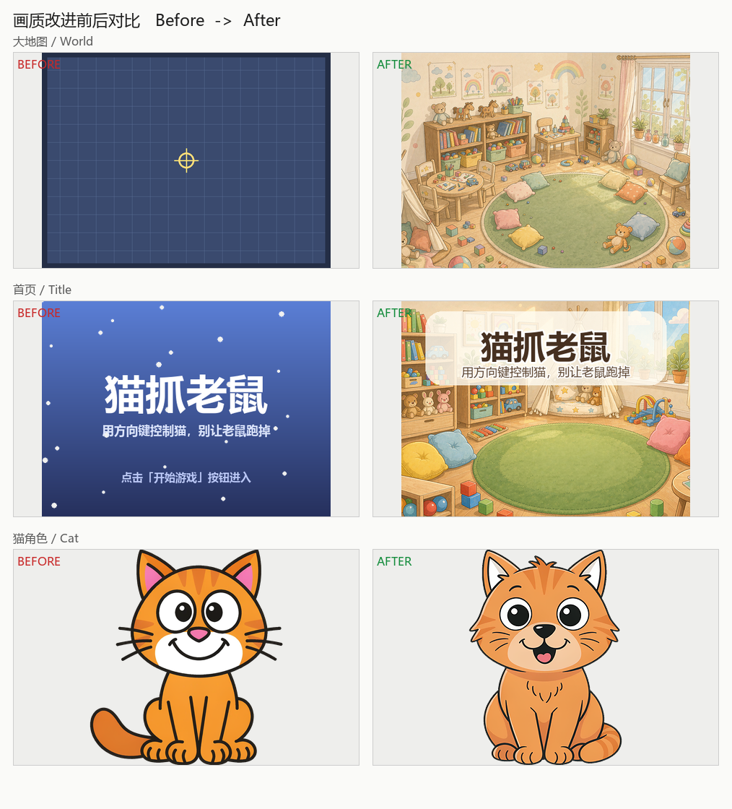

<div align="center">

# ai-scratch-maker

**让 AI 生成高质量 Scratch 3.0 作品（.sb3）**

AI 不直接写 `.sb3` 的 JSON 数组（极易出错），而是写一份人类可读的**中间表示（IR）**，
由序列化器编译成合法、能被 Scratch 打开并运行的 `project.json` + 素材。

[快速上手](#快速上手) · [核心工作流](#核心工作流) · [质量保障](#质量保障体系) · [示例作品](#示例作品) · [许可](#许可)

</div>

---

## 为什么需要它

让 AI 直接生成 `.sb3`，失败率极高——`.sb3` 本质是一个巨型 JSON 数组，
积木靠 20 位随机 ID 互相引用，错一个字段就是「作品打不开」。常见的坑：

| 手写 sb3 的坑 | 本项目怎么避免 |
|---|---|
| 菜单下拉写成数组而不是裸字符串 | 序列化器统一编码成 `[1, "值"]` |
| 变量该放 `fields` 却塞进了 `inputs` | 积木规范**从 Scratch 官方源码抽取**，位置天然正确 |
| opcode 拼错（`looks_seteffect` ≠ `looks_seteffectto`） | 规范自动抽取 + 运行时原语交叉校验 |
| 变量名被二次编码成字符串 | 校验器专门检查这种畸形 |
| 自定义积木缺 `tagName` / `children` | 序列化器自动生成完整 mutation |
| 云变量作用域搞错 | 舞台变量自动全局共享，角色不重复创建 |
| 漏掉某个积木 | 抽取脚本保证「运行时原语 100% 收录」 |

覆盖 Scratch 官方 **全部 188 个积木**（含画笔 / 音乐 / 朗读 / 翻译扩展）与云变量。

---

## 快速上手

```bash
cd ai-scratch-maker

# 1) 写一份 IR（YAML 或 JSON）
#    2) 编译成 .sb3
python3 scripts/build_sb3.py --ir examples/cat_chase.yaml --out 作品.sb3 --workdir /tmp/wd

# 3) 三重校验（结构 / 官方 Schema / scratch-vm 运行时）
python3 scripts/validate_sb3.py --sb3 作品.sb3
```

输出：

```
结构校验通过: 作品.sb3
  targets=2 blocks=25 extensions=['pen']
  [ok] 官方 schema 校验: SCHEMA_OK
  [ok] 运行时校验: RUNTIME_OK targets=2
全部校验通过 ✅
```

### 环境依赖

| 依赖 | 版本 | 用途 |
|---|---|---|
| Python | ≥ 3.8（含 PyYAML、Pillow） | IR 解析、构建器、门禁、评分卡 |
| Node.js | ≥ 18 | schema / parser / runtime 校验器 |
| npm 依赖 | 见 `package.json` | `ajv` 等 5 个包，`npm install` 安装 |

> 校验器需要 Scratch 运行时做交叉验证。若本机没有 `scratch-vm`，
> `scripts/scratch_vm_path.mjs` 会给出提示；缺少时结构校验与官方 schema 校验仍可运行。

---

## 目录结构

```
ai-scratch-maker/            # Skill 本体（安装这一个目录即可）
├── SKILL.md                 # AI 的工作流说明书：铁律 + 步骤 + 验收清单
├── scripts/                 # 80+ 个工具：构建 / 校验 / 门禁 / 生成 / 拆解
├── references/              # 62 篇手册（8.6MB）：技巧大全 + 铁律详解 + UI 规范
├── examples/                # 30+ 个可运行示例工程 + 10 张质量门禁规格表
├── assets/                  # 自产素材（SVG / PNG / WAV）
└── raw_assets/              # 生成管线的素材输入样本
community-crawler/           # 社区作品调研工具（只含代码，不含抓取到的作品）
deploy-tools/pack_skill.py   # 打包分发脚本
```

`references/handbook-index.md` 是手册索引入口，共 **40 册**（§1–§502）+ 社区补编（§C1–§C7）。

---

## 核心工作流

> **关键理念：不要从零拼 IR。**

一个「全绿但不好玩」的 .sb3 是最常见的失败模式——技术上合法，体验上平庸。
本项目把**质量抬到生成起点**：

```bash
# 从已验收的完整作品骨架起手（不是空模板）
python3 scripts/new_project.py --genre catch --name 星空拾贝 --slug star_catch
```

`new_project.py` 会复制一份**已通过全部门禁**的成品 IR（含首页、状态机、结算页、
复位、手感层、音效），你只改玩法与素材，不重搭骨架。可用骨架：

| `--genre` | 来源原型 | 适用 |
|---|---|---|
| `catch` | 水果篮子 | 接住掉落物、计分、连击 |
| `platformer` | 云间跳跃 | 横版关卡、跳跃手感、多帧动画 |
| `whack` | 打地鼠 | 短局点击、难度递增 |

其余流程：

```
脚手架 new_project.py  →  写 IR  →  素材（生图 / 矢量）  →  构建
      →  质量门禁 quality_gate.py  →  评分卡 scorecard.py  →  铁律检查  →  交付
```

`scripts/generate_staged.py` 把这条链编排成**分层流水线**，每阶段失败即停：

```bash
python3 scripts/generate_staged.py --genre catch --name 星空拾贝 --raw-assets raw/
```

---

## 质量保障体系

这是本项目与「让 AI 随便生成一个 sb3」最大的差别。

### ① 八层结构校验（`verify_project.sh` 阶段 1）

L1 结构 → L2 官方 Schema → L3 解析器 → L4 运行时，
对全库每个 .sb3 逐一验证**能真的在 Scratch 里跑**。

> ⚠️ **质量门禁 ≠ 完整 verify**：门禁不查官方 schema。
> 本项目曾因此让一个 `rotationStyle: none`（官方枚举非法值）溜过门禁、
> 却在完整 verify 的 L2 阶段才暴露。**发布前务必跑一次完整 verify。**

### ② 质量门禁六层（`quality_gate.py`）

| 层 | 查什么 |
|---|---|
| A 资产密度 | 造型数 / 音效数 / 角色数 / 场景数 / 积木数 / 产物体积下限 |
| B 玩法完整度 | 得分、难度递增、结算、复位、重玩价值 |
| C 观感质量 | 渐变体积感、窗口圆角、缓动过渡、配色合规（§198 色板） |
| D 生图硬闸 | **关键造型必须是「合适资产」**：矢量 SVG 或带透明通道的位图 |
| E 动画完备性 | 帧动画 / 造型切换（game、showcase 类硬拦） |
| F 音效密度 | 四层响度体系（ui / fx / ev / amb） |

### ③ 铁律静态检查（`check_hard_rules.mjs`）

29 条铁律中可静态检查的 9 条逐条把关（数字完整显示、对话用自制聊天框、
障碍必有碰撞箱、复位挂 `[重置]`、结算页必须有返回按钮……）。

### ④ 行为回归（`regress_behavior.sh`）

23 个作品专属行为校验 + 通用深网 32 项非标杆校验 + 全量启动冒烟。

### ⑤ 评分卡（`scorecard.py`）

六维 1–5 分加权评级 S / A / B / C / D，附明细，便于横向比较迭代效果。

### 一键验收

```bash
cd ai-scratch-maker && bash scripts/verify_project.sh --jobs 4
```

覆盖：全量构建 → 生成管线自检 → 八层结构校验 → 铁律 → L7 语义回归 →
启动冒烟 + 行为回归 → 质量门禁 → 性能/可访问性增量嗅觉（advisory）。

---

## 铁律（29 条，摘录）

完整清单见 `SKILL.md` 与 `references/quality-checklist.md`。

1. 数字完整显示 + 文字标签 · 2. 对话用自制聊天框，不用 say 气泡 ·
3. 署名 CC BY-SA，**禁止写「禁止改编」** · 4. 障碍必有碰撞箱 ·
5. 摩擦/阻尼用乘不用减 · 6. 复位挂 `[重置]` 不挂绿旗 ·
7. **结算页必须有返回 / 再来一局按钮** · 8. y+ 朝上，重力取负 ·
13. 配色只取 §198 的 18 个 HEX · 14. 窗口圆角 + 大窗 GHOST25 + 关闭图标 ·
15. 质感靠曲线而不是换素材 · 16. 控制分三层（包络 / 规划 / 执行）+ 死区非对称 ·
17. UI 矢量 + 五层体积感（投影→外描边→渐变→顶高光→底内阴，顺序不可换） ·
18. 音效四层响度 ui-18 / fx-9 / ev-3 / amb-15 dBFS ·
19. 算法先写 Python 基线 + 已知答案断言 · 29. 射击/摸金复刻的两条轴与四层判定

---

## 示例作品

10 个带质量门禁规格表（`--strict` 全过）的完整工程：

| 作品 | 类型 | 评级 | 说明 |
|---|---|---|---|
| `fruit_basket` | game | **S 4.75** | 接水果：计分 / 生命 / 关卡 / 结算 |
| `star_catch` | game | **S 4.75** | 星空拾贝：夜间配色 + 缓动 |
| `cat_mouse` | game | A 4.20 | 猫抓老鼠：分轴碰撞、按钮式菜单 |
| `match3` | game | A 4.20 | 三消：特效精灵 + 连击 |
| `rps` | game | A 4.35 | 石头剪刀布：三局两胜 |
| `quiz` | edu | A 4.45 | 问答课件：全矢量 UI |
| `platformer` | game | A 4.05 | 平台跳跃：四帧跑动动画 |
| `music_band` | music | A 4.05 | 乐队：多声部 = 多角色 |
| `story` | story | A 4.05 | 互动故事 |
| `whack_a_mole` | game | A 4.05 | 打地鼠：短局点击 |

另有 `shooter` / `metro` / `ato_train` / `card_game` / `board_gomoku` /
`rhythm_game` / `tower-defense` / `firstperson` / `3d_demo` 等题材工程，
以及 `examples/community/` 下的社区素材管线示例。

---

## 素材策略

**矢量优先**。角色的关键造型优先用 SVG 表达，配色只从 §198 的 18 色板取，
再套五层体积感（铁律 17）：

```bash
python3 scripts/enhance_svg.py --in-dir 素材目录 --out-dir 输出目录   # 自动补五层体积感
python3 scripts/gen_ui_kit.py      # 177 个 UI 矢量件（面板/按钮/图标）
python3 scripts/gen_fruit_art.py    # 水果 / 装饰 / 背景等自产素材
python3 scripts/gen_sfx_kit.py      # 22 个音效（四层响度）
python3 scripts/gen_audio.py bgm    # 程序化 BGM
```

需要位图时用生图，再走 `prep_asset.py`（裁填 / 抠底 / 去水印 / 镜像造型）：

```bash
python3 scripts/prep_asset.py --in 原图.png --out 素材.png --remove-bg --check-alpha
```

> 🔒 默认最高质量：除非用户明确要求降级，一律 `quality: high` + 大尺寸出图。

### 画质对比

同一批素材，走本项目的素材管线前后的差别（`docs/art-quality-comparison.png`）：



左列是「占位/未加工」的状态——空网格背景、只有文字的标题页、简笔画角色；
右列是走完 `prep_asset.py`（裁填 + 抠底 + 去水印）与 `enhance_svg.py`
（五层体积感）之后的成品。**观感差距主要来自管线，不来自模型。**

### 社区素材（未随仓库分发）

社区素材包里的造型/音效来自第三方 Scratch 社区的公开作品，
其授权声明要求「对外分发前须回溯原作者授权」，因此**本体不随仓库分发**，
只保留工具与索引。使用者可在本机自行获取：

```bash
python community-crawler/extract_asset_pack.py     # 需要网络
export COMMUNITY_ASSET_LIBRARY=/abs/path/to/library
```

未接入时构建器自动降级为程序化占位素材并告警，不会中断。详见
[THIRD-PARTY-NOTICES.md](THIRD-PARTY-NOTICES.md) 与
`ai-scratch-maker/examples/community/README.md`。

---

## 安装为 Skill

把 `ai-scratch-maker/` 整个目录放进你的 agent 的 skills 目录即可，例如：

```bash
cp -r ai-scratch-maker ~/.workbuddy/skills/ai-scratch-maker
```

`SKILL.md` 的 frontmatter 就是 skill 声明（`name` / `description` / `type` / `version`）。

打包成 zip 分发：

```bash
python deploy-tools/pack_skill.py --exclude-outputs --out ai-scratch-maker.zip
python deploy-tools/pack_skill.py --exclude-outputs --portable --out ai-scratch-maker-portable.zip
```

> `pack_skill.py` 用手写 argv 解析（无 argparse），`--help` 会被忽略并**直接执行打包**。

---

## 许可与署名

本仓库的代码、文档与自产素材采用 **[CC BY-SA 4.0](LICENSE)**。

使用本项目生成的素材或产出的 .sb3 作品时：

- 署名「ai-scratch-maker」并附上本仓库链接；
- **不得附加「禁止改编 / 请勿复制 / 私人作品」等限制**——这既是本项目的铁律 3，
  也是 CC BY-SA 的要求；
- 第三方素材与未分发内容的原因见 [THIRD-PARTY-NOTICES.md](THIRD-PARTY-NOTICES.md)。

---

<div align="center">
<sub>用 IR 写作品，让 AI 产出「能打开、能玩、还挺好玩」的 .sb3。</sub>
</div>
